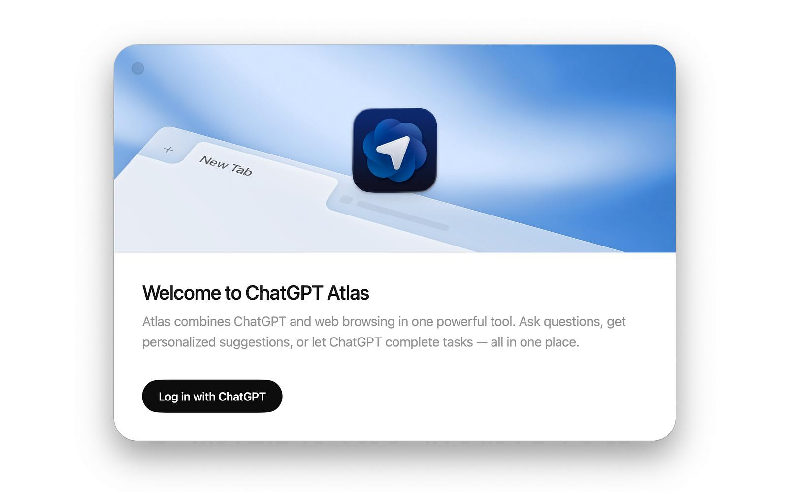
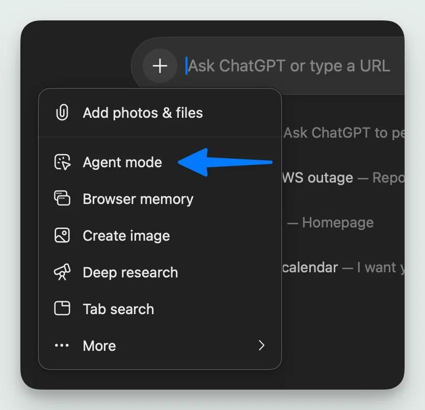
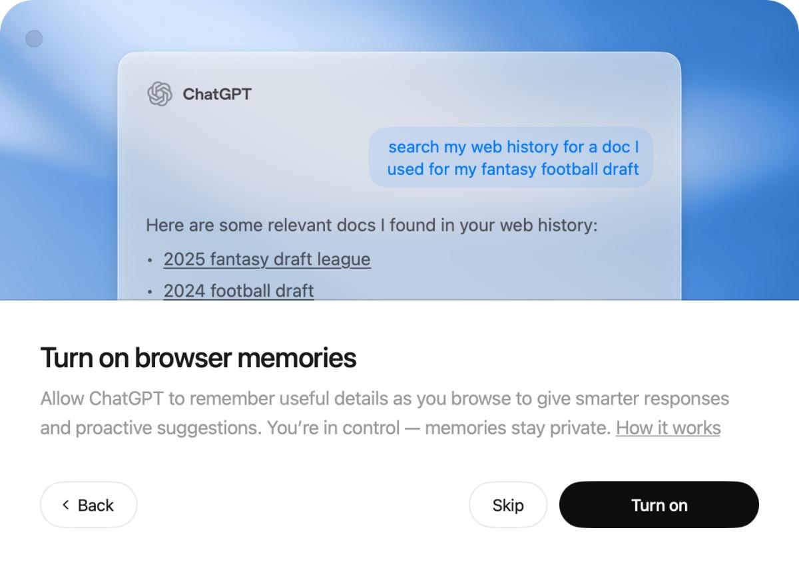
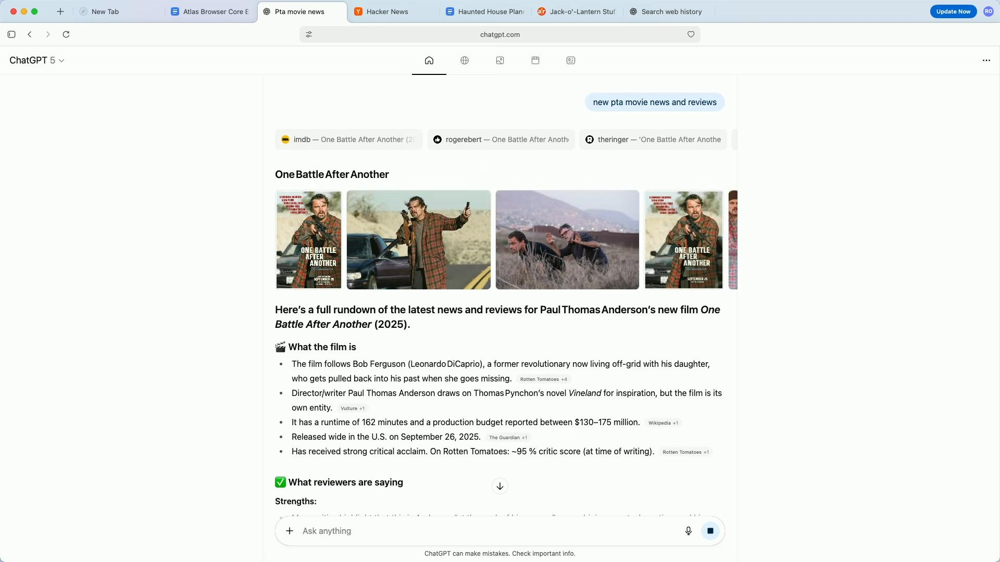
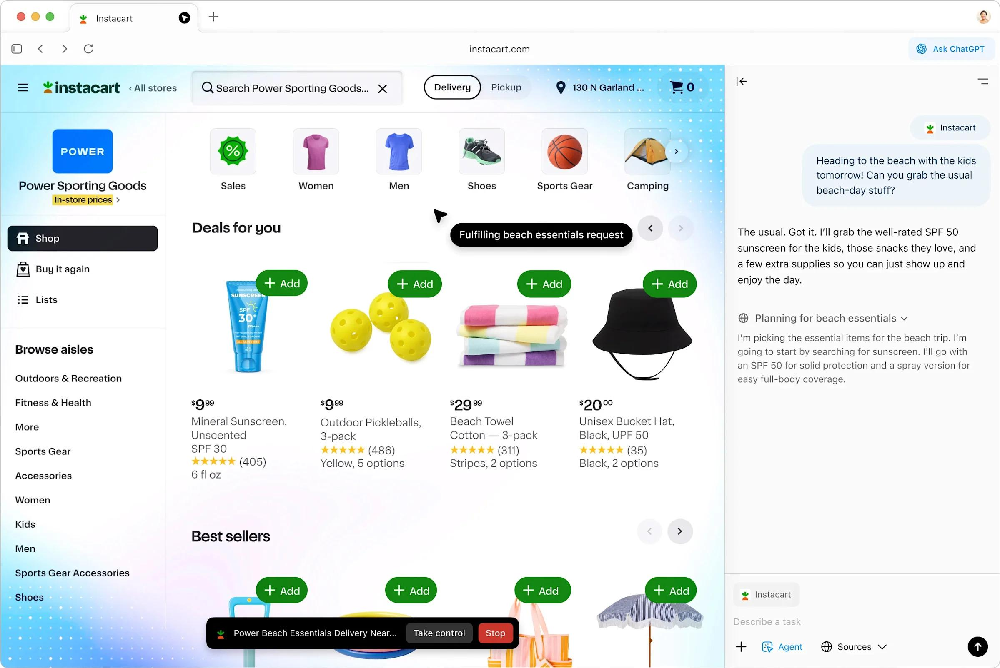
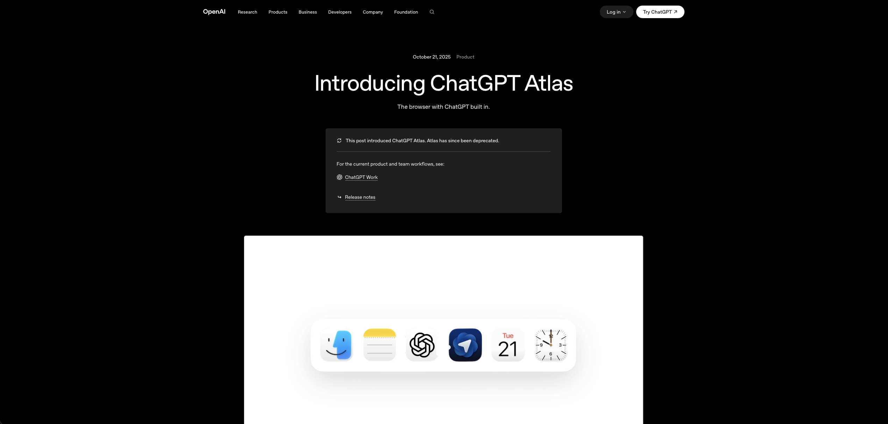

# ChatGPT Atlas

*A browser built around ChatGPT.*

---

ChatGPT Atlas was an AI-powered web browser developed by OpenAI, integrating ChatGPT directly into the browsing experience.

## Product Information

| Field | Details |
|---|---|
| Developer | OpenAI |
| Category | AI Web Browser |
| Platform | macOS |
| Architecture | Apple Silicon |
| Released | October 21, 2025 |
| Retired | August 9, 2026 |
| Status | Discontinued |

## Historical Software

| Version | Platform | Format | Status |
|---|---|---|---|
| 1.2026.119.1 | macOS | DMG | Unverified |
| 1.2026.189.1 | macOS | DMG | Unverified |

### Original Download Links

- [Version 1.2026.119.1](https://persistent.oaistatic.com/atlas/public/ChatGPT_Atlas_Desktop_public_1.2026.119.1_20260504231115000.dmg)
- [Version 1.2026.189.1](https://persistent.oaistatic.com/atlas/public/ChatGPT_Atlas_Desktop_public_1.2026.189.1_20260724200710000.dmg)

## Website Archive

- [Original Website](https://chatgpt.com/atlas)
- [Wayback Machine](https://web.archive.org/web/*/https://chatgpt.com/atlas)

## Gallery

### Welcome Screen

*Source: [DataCamp](https://www.datacamp.com/tutorial/chatgpt-atlas-guide)*

### Agent Mode Menu

*Source: [note.com](https://note.com/)*

### Browser Memory Setup

*Source: [DataCamp](https://www.datacamp.com/tutorial/chatgpt-atlas-guide)*

### ChatGPT Sidebar

*Source: [Tom's Guide](https://www.tomsguide.com/computing/browsers/i-just-tried-chatgpt-atlas-as-a-long-time-chrome-user-heres-what-i-love-and-hate)*

### Agent Mode Execution

*Source: [DataCamp](https://www.datacamp.com/tutorial/chatgpt-atlas-guide)*

### Retirement Screen

*Captured by AI Graveyard on November 17, 2026.*

### Image Credits

Third-party screenshots are credited to their respective sources.

All images, trademarks, and intellectual property remain the property of their respective owners.

## Timeline

- **October 21, 2025** — Official launch of ChatGPT Atlas.
- **October 30, 2025** — OpenAI introduces the OWL browser architecture.
- **August 9, 2026** — ChatGPT Atlas is retired.

## Official Documentation

- [Introducing ChatGPT Atlas](https://openai.com/index/introducing-chatgpt-atlas/)
- [Building ChatGPT Atlas](https://openai.com/index/building-chatgpt-atlas/)
- [Release Notes](https://help.openai.com/en/articles/12591856-release-notes)
- [Retirement Notice](https://help.openai.com/en/articles/20001371-chatgpt-atlas-retirement)

## Reason for Retirement

OpenAI transitioned browser-based agentic capabilities into ChatGPT and Codex, discontinuing Atlas as a standalone browser.

## Disclaimer

This is an independent historical archive.
All intellectual property belongs to its respective owners.

---

*Gone, but not forgotten.*

