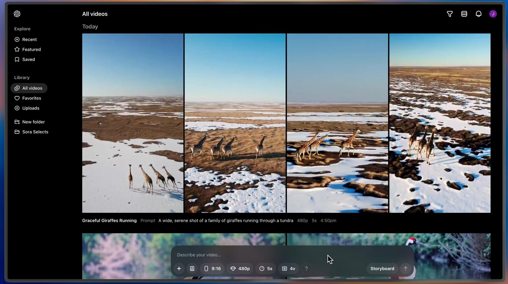
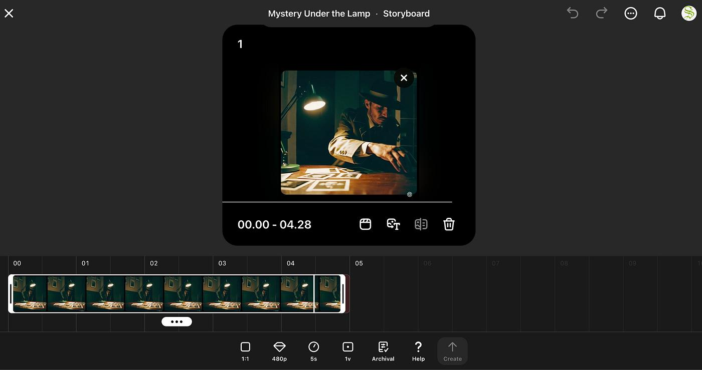
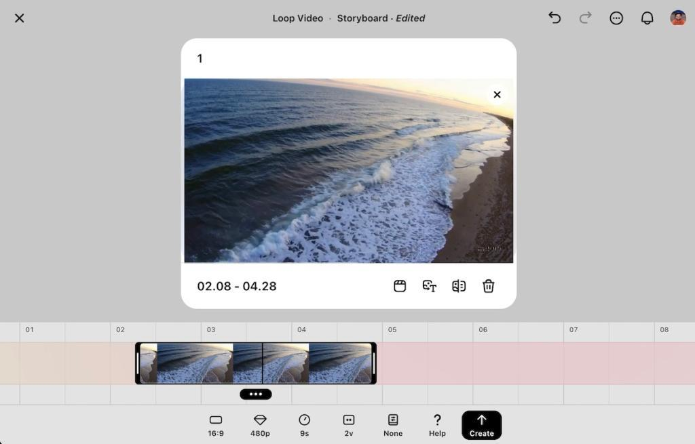
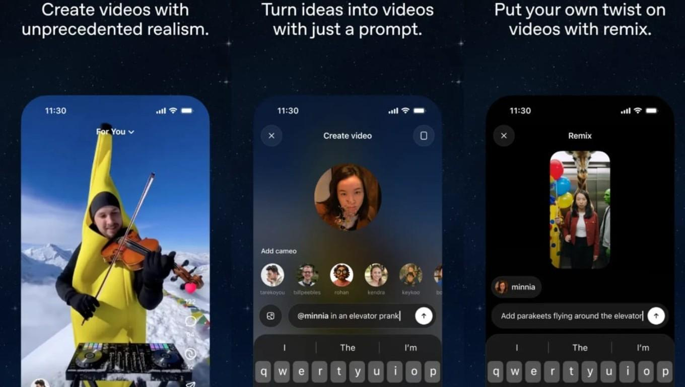
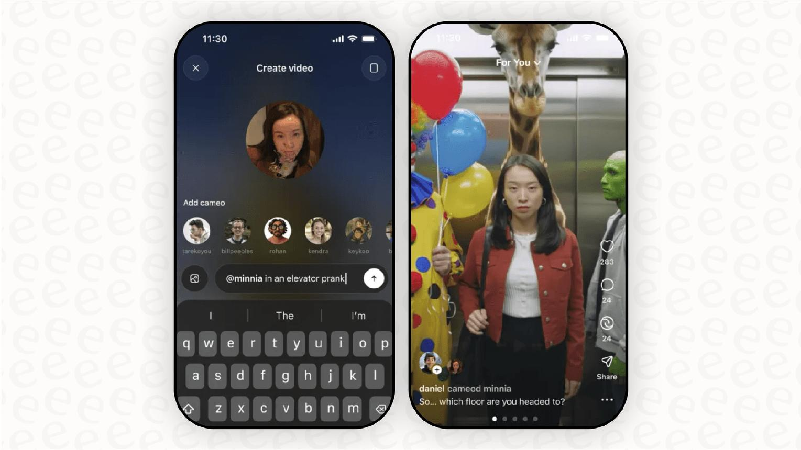

# OpenAI Sora

*Creating video from imagination.*

---

Sora was an AI-powered video generation system developed by OpenAI, capable of generating videos from text, images, and video inputs.

## Product Information

| Field | Details |
|---|---|
| Developer | OpenAI |
| Category | AI Video Generation |
| Platform | Web, iOS, Android, API |
| First announced | February 15, 2024 |
| Public release | December 9, 2024 |
| Sora 2 release | September 30, 2025 |
| Web and app shutdown | April 26, 2026 |
| API shutdown | September 24, 2026 |
| Status | Discontinued |

## Historical Software

| Product | Platform | Format |
|---|---|---|
| Sora | Android | APK |
| Sora | iOS | IPA |

Android historical versions are available through third-party archives.

The availability of original iOS installers remains unverified.

## Website Archive

- [Original Website](https://sora.com/)
- [Wayback Machine](https://web.archive.org/web/*/https://sora.com/)
- [Original Sora Preview](https://openai.com/index/sora/)

## Gallery

### Sora 1 — Web Interface

*Source: [Neowin](https://www.neowin.net/news/openais-sora-ai-video-generation-tool-is-now-available-for-chatgpt-plus-and-pro-users/)*

### Sora 1 — Storyboard

*Source: [Daniel Warfield / Medium](https://medium.com/intuitively-and-exhaustively-explained/a-practical-exploration-of-sora-intuitively-and-exhaustively-explained-57426b269a26)*

### Sora 1 — Re-cut

*Source: [Beebom](https://beebom.com/openai-sora-features/)*

### Sora 2 — Mobile App

*Source: [SaDesign](https://sadesign.ai/openai-launches-sora-2-ai-creates-realistic-videos-opens-social-network-to-compete-with-tiktok)*

### Sora 2 — Cameo

*Source: [eesel AI](https://www.eesel.ai/blog/sora-2-in-the-api)*

## Timeline

- **February 15, 2024** — OpenAI announces Sora.
- **December 9, 2024** — Sora becomes publicly available.
- **September 30, 2025** — Sora 2 and the Sora app are introduced.
- **April 26, 2026** — Web and mobile services are discontinued.
- **September 24, 2026** — The Sora API is discontinued.

## Official Documentation

- [Introducing Sora](https://openai.com/index/sora/)
- [Sora is here](https://openai.com/index/sora-is-here/)
- [Sora 2 is here](https://openai.com/index/sora-2/)
- [Sora 2 System Card](https://openai.com/index/sora-2-system-card/)
- [Official Discontinuation Notice](https://help.openai.com/en/articles/20001152)

## Current Functionality

The original video generation services are no longer operational.

## Disclaimer

This is an independent historical archive.

Third-party screenshots are credited to their respective sources. All intellectual property belongs to its respective owners.

---

*Gone, but not forgotten.*
