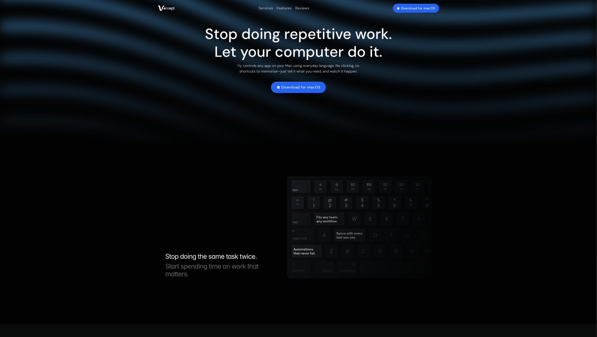

# Vercept Vy

*Less chatting, more doing.*

---

Vy was an AI-powered computer-use agent developed by Vercept, designed to interact with desktop applications and complete tasks using natural language.

## Product Information

| Field | Details |
|---|---|
| Developer | Vercept |
| Category | Computer Use Agent |
| Platform | macOS, Windows |
| Status | Discontinued |
| Acquired by | Anthropic |
| Acquisition | February 25, 2026 |
| Shutdown | March 25, 2026 |

## Historical Software

| Version | Platform | Architecture | Status |
|---|---|---|---|
| 0.7.3 | macOS | ARM64 | Download unavailable |
| 0.7.10 | macOS | ARM64 | Preserved locally |

The preserved 0.7.10 DMG was repackaged from a previously installed application. It is not the original official installer.

## Website Archive

- [Official Website](https://vercept.com/)
- [Framer Landing Page](https://vercept.framer.website/)
- [December 16, 2025 Snapshot](https://web.archive.org/web/20251216133314/https://vercept.com/)

## Gallery

### Framer Landing Page

*Captured on November 17, 2026.*

## Timeline

- **2025** — Vy becomes available to users.
- **December 2025** — Cross-platform expansion.
- **February 25, 2026** — Vercept announces its acquisition by Anthropic.
- **March 25, 2026** — Vy services are discontinued.
- **November 17, 2026** — Version 0.7.10 is preserved by AI Graveyard.

## Official Announcements

- [Vercept is joining Anthropic](https://vercept.com/)

## Current Functionality

The preserved macOS application can still launch, but it can no longer connect to its original cloud services.

## Disclaimer

This is an independent historical archive.
All intellectual property belongs to its respective owners.

---

*Gone, but not forgotten.*

